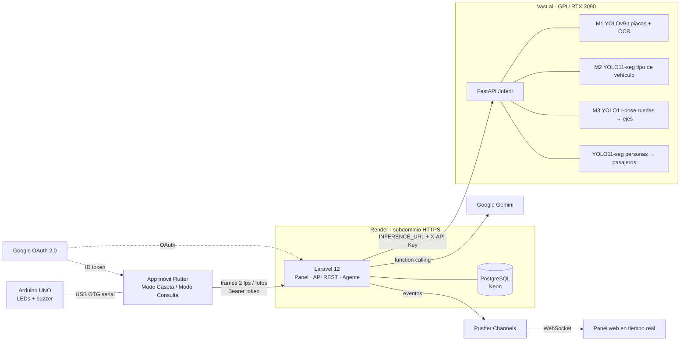

# Sistema Inteligente de Control de Peaje

**IAM-811 Machine Learning y Aprendizaje Profundo · Laboratorio final de hito (entrega individual)**

Sistema de punta a punta: una app móvil captura video en la caseta y envía frames a una aplicación web en la nube. La web llama a un endpoint de inferencia con GPU en Vast.ai con tres modelos de deep learning (placa + OCR, tipo de vehículo, ejes) más un conteo de pasajeros, cobra la tarifa, genera alertas y lo muestra todo **en tiempo real**. Un agente conversacional responde el estado de cualquier placa por texto o por imagen. El acceso es exclusivamente con Google.

## Integrantes

| Integrante | Rol |
|---|---|
| _Nombre completo_ | Dataset, entrenamiento, inferencia, web/agente, app móvil y hardware (entrega individual) |

## Enlaces

| Componente | URL |
|---|---|
| Aplicación web (subdominio HTTPS) | `https://peaje-ia.onrender.com` |
| Documentación de la API (Swagger) | `https://peaje-ia.onrender.com/api/docs` |
| Endpoint de inferencia (Vast.ai) | `https://instrumental-democrat-folk-tables.trycloudflare.com/salud` |
| Dataset M2 (Roboflow) | `https://universe.roboflow.com/<workspace>/peaje-vehiculos-seg` ← reemplazar |
| Datasets M3 (Roboflow Universe) | [axle](https://universe.roboflow.com/eternal-wiecw/axle-bjpov) y [truck axel](https://universe.roboflow.com/rajan-28noy/truck-axel), más fotos propias |
| Carpeta de evidencias | Google Drive ← reemplazar |

## Arquitectura



Flujo de un paso: **app** (frame) → `POST /api/v1/pasos/frame` → **web** → `POST {INFERENCE_URL}/inferir` → JSON `{placa, confianza, categoria, ejes, pasajeros, latencia_ms}` → tarifa por categoría y ejes → cobro o alerta → **Pusher** → panel sin recargar → respuesta a la app → señal al **Arduino**.

La web no sabe dónde corre la inferencia: cambiar de proveedor (Vast.ai, RunPod, Colab) es solo cambiar `INFERENCE_URL`.

## Estructura

```
/entrenamiento   notebooks de Colab: M2 segmentación, M3 keypoints, M1 validación OCR, pasajeros, inferencia en Colab
/inferencia      endpoint FastAPI con los modelos + arranque en Vast.ai y RunPod + diagnóstico de entorno
/web             Laravel 12: panel, CRUD, API REST, Google OAuth, tiempo real (Pusher), agente (Gemini)
/movil           app Flutter (Android): Google Sign-In, modo Caseta, modo Consulta, Arduino por USB
/hardware        sketch del Arduino UNO (dispositivo de alerta)
/docs            guía de despliegue, OpenAPI y plantilla del informe
render.yaml      blueprint de Render
```

## Tecnologías

| Capa | Tecnología |
|---|---|
| Datasets | Roboflow (Instance Segmentation y Keypoint Detection), con imágenes propias |
| Entrenamiento | Google Colab (GPU T4); reentrenamiento de M3 en Vast.ai (RTX 3090). Ultralytics YOLO11 8.3.240 |
| M1 | YOLOv9-t ONNX (proyecto anterior) + fast-plate-ocr (CCT, ONNX); EasyOCR como alternativa |
| M2 | YOLO11s-seg propio (moto, auto, minibus, camion, bus) con respaldo COCO si no detecta |
| M3 | YOLO11s-pose propio (5 keypoints por llanta; el centro define el eje), sobre el recorte del vehículo de M2 |
| Pasajeros | YOLO11n-seg, clase persona dentro de la caja del vehículo; evidencia solo con máscara |
| Inferencia | FastAPI + Uvicorn en una instancia GPU de Vast.ai, publicada con túnel HTTPS |
| Web | Laravel 12 (PHP 8.4), Blade, Sanctum, Socialite, Docker en Render |
| Base de datos | PostgreSQL gestionado (Neon) |
| Tiempo real | Pusher Channels (canal privado `private-panel`) |
| Agente | Google Gemini 3.5 Flash con function calling (`consultar_placa`), con respaldo por reglas |
| Móvil | Flutter 3 (Android): `google_sign_in`, `camera`, `image_picker`, `usb_serial` |
| Hardware | Arduino UNO + LEDs + buzzer por USB OTG |

## Reglas de negocio

- **Tarifas** (tabla `tarifas`): la categoría define la tarifa base; para camión y bus el número de ejes define el monto (si M3 detecta más ejes que la tarifa más alta, se cobra la más alta).
- **Estados del paso**: `cobrado` (descuenta saldo), `sin_saldo`, `no_registrada`, `vehiculo_inactivo`. Los tres últimos generan una **alerta** en tiempo real.
- **Anti-duplicados**: la app envía 2 fps; un mismo vehículo cuenta un solo paso por caseta durante 60 s.
- **Confianza mínima del OCR**: 0.5 (`PEAJE_CONFIANZA_MINIMA`).
- **Agente**: normaliza la placa (mayúsculas, sin guiones ni espacios), valida el formato y responde uno de los 4 estados (*Registrada y con paso*, *Registrada sin paso*, *Identificada no registrada*, *No existe*). Sugiere coincidencias por errores de OCR (O↔0, I↔1, B↔8, S↔5, Z↔2, G↔6, o una letra de diferencia). Los datos salen solo de la BD.
- **Roles**: `admin` gestiona vehículos, tarifas, casetas y la lista blanca; `operador` registra pasos y consulta placas. La cuenta `doc.alvaro.pinto.ma@unifranz.edu.bo` se crea siempre como admin.

## API REST

Documentada en OpenAPI 3 (`web/openapi.yaml`, Swagger UI en `/api/docs`). Todas las rutas, salvo `/auth/google`, exigen `Authorization: Bearer`.

| Método | Ruta | Descripción |
|---|---|---|
| POST | `/api/v1/auth/google` | ID token de Google → token del sistema (solo lista blanca) |
| POST | `/api/v1/pasos/frame` | Frame → inferencia → paso → tiempo real |
| POST | `/api/v1/placas/consultar` | Estado de una placa por texto |
| POST | `/api/v1/placas/consultar-imagen` | Estado de una placa por imagen (M1 + OCR) |
| GET | `/api/v1/placas/{placa}/historial` | Historial de pasos |
| GET | `/api/v1/casetas/{id}/resumen` | Conteo y recaudación del día |
| POST | `/api/v1/agente/chat` | Mensaje (texto o imagen) al agente |
| GET | `/api/v1/casetas`, `/api/v1/yo` | Auxiliares para la app |

## Despliegue

La guía completa, paso a paso, está en **[docs/GUIA_DESPLIEGUE.md](docs/GUIA_DESPLIEGUE.md)**. En resumen:

1. **Google Cloud**: proyecto, pantalla de consentimiento, clientes OAuth *Web* y *Android*.
2. **Roboflow + Colab**: etiquetar, entrenar con los notebooks de `/entrenamiento`, guardar `m2_seg.pt` y `m3_pose.pt`.
3. **Vast.ai**: instancia con la plantilla PyTorch, `git clone`, `bash inferencia/iniciar_vast.sh` y túnel a `http://localhost:8000` en el Instance Portal. (Alternativa: RunPod con `iniciar_runpod.sh`).
4. **Neon + Pusher + Gemini**: crear la BD, la app de Pusher y la API key de Gemini.
5. **Render**: *New → Blueprint* con este repositorio y completar las variables de `web/.env.example`.
6. **App**: `flutter build apk --release --dart-define=API_URL=... --dart-define=GOOGLE_WEB_CLIENT_ID=...`.
7. **Arduino**: cargar `hardware/alerta_peaje/alerta_peaje.ino` y conectarlo al celular con un cable OTG.

## Entornos (punto adicional)

| Servicio | Archivo de entorno | Cómo recrearlo |
|---|---|---|
| Inferencia (Vast.ai) | `inferencia/requirements_vast.txt` (versiones fijadas) | `bash inferencia/iniciar_vast.sh` sobre el entorno `venv` de la plantilla PyTorch (`/venv/main`, Python 3.12, torch 2.14.1+cu132) |
| Inferencia (Colab) | `inferencia/requirements.txt` | primera celda de `entrenamiento/Inferencia_en_Colab.ipynb` |
| Entrenamiento (Colab) | `entrenamiento/requirements.txt` | primera celda de cada notebook |
| Reentrenamiento M3 (Vast.ai) | versiones en `entrenamiento/M3_reentrenar_nube.ipynb` | primera celda del notebook |
| Web | `web/composer.lock` + `web/Dockerfile` (PHP 8.4) | imagen Docker construida por Render |
| Móvil | `movil/pubspec.lock` | `flutter pub get` |

Diagnóstico: `python inferencia/diagnostico.py` (versión de Python, torch, CUDA, ultralytics) y la celda de diagnóstico de cada notebook. Las salidas van a la carpeta de evidencias.

## Pruebas

```bash
cd web && composer install && php artisan test     # 11 pruebas: auth, lista blanca, 4 estados, cobro, alertas, agente
cd movil && flutter analyze
```

## Seguridad y privacidad

- No hay secretos en el repositorio: solo `.env.example`. Las claves viven en las variables de entorno de Render y en los secretos de Colab; en Vast.ai se escriben al arrancar y no se guardan en disco.
- El endpoint de inferencia exige `X-API-Key`.
- Las imágenes de evidencia se guardan en la BD y solo se sirven a usuarios autenticados. Los pasajeros se cubren con máscara: no hay reconocimiento facial ni recortes de rostros.
